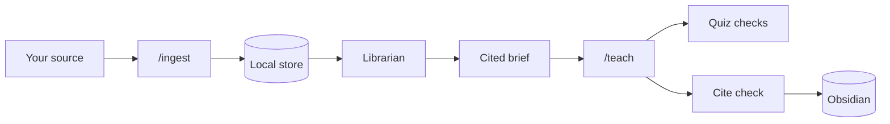

# Project Schola: a Socratic AI tutor for Claude Code that teaches from your PDFs and textbooks

**Learn any topic, or any book you own, from first principles, with multiple-choice checks, verified citations, spaced review and live Obsidian notes. Local-first.**

[Quick start](#quick-start) · [Features](#features) · [How it works](#how-it-works) · [Supported sources](#supported-sources) · [Commands](#commands) · [FAQ](#faq) · [Limits](#known-limits)

---

## What is Project Schola?

Project Schola is an open-source Claude Code plugin that turns Claude into a Socratic private tutor. It finds the edge of what you already know, proposes a lesson plan as a dependency map, then teaches one idea at a time and checks each with a multiple-choice quiz. It can also ingest a PDF, EPUB, web page, slide deck or video transcript into a local store and teach from that source's own outline, with every quote checked against the source text and page numbers rendered by code. Session notes sync live to your Obsidian vault.

Schola rests on two teaching principles:

1. **Unconditional truths first.** Start from facts you can accept at face value, with no caveats, and build everything else on top of them.
2. **"How could I have discovered this?"** Every step is motivated by the problem it solves, so nothing feels arbitrary (in the style of 3Blue1Brown).

## Quick start

Built and tested on macOS. You need [Claude Code](https://claude.com/claude-code), `python3`, and Homebrew.

```bash
brew install jq poppler mermaid-cli librsvg
git clone https://github.com/OJ102/ProjectSchola.git ~/schola
claude --plugin-dir ~/schola
```

Then, inside Claude Code:

```text
/teach Fourier transforms
/ingest ~/Books/ddia.pdf
/teach ddia
```

Session notes go to `$OBSIDIAN_VAULT_PATH` (default `~/Obsidian/learn`). Set it in your shell profile before launching Claude Code:

```bash
export OBSIDIAN_VAULT_PATH=~/Obsidian/learn
```

Optional tools, needed only for some sources: `pandoc` (EPUB, DOCX, slides), `tesseract` (OCR outside macOS), `ffmpeg` and `openai-whisper` or `whisper-cpp` (local video without captions), `yt-dlp` (YouTube and Vimeo). When a tool is missing, `/ingest` prints the exact `brew install` command.

## Features

### Socratic tutoring with `/teach`

- **Probe:** adaptive multiple-choice questions that bracket your knowledge on each prerequisite: a floor you get right and a ceiling you miss. A run of correct answers makes the questions harder; it does not end the probe.
- **Plan:** a short written approach plus a mermaid dependency map (unconditional truths at the roots, your goal at the sink). Teaching starts only after you approve it.
- **Teach:** each node is motivated, established, connected to what you already hold, then quiz-checked.
- **Fair quizzes:** options are bare, parallel claims; distractors encode real misconceptions; the order is shuffled; an "I haven't encountered this yet" option protects calibration.
- **Fact checks:** the tutor is told to confirm any uncertain fact with a research subagent before teaching it.
- **Math as LaTeX:** formulas render in the Obsidian log.

### Learn from a PDF, textbook or docs site

- **`/ingest`** turns a source into a normalized local store with printed page labels (roman-numeral front matter and footer outliers are handled), an outline and a unit map.
- **`/teach <slug>`** follows the book's own order and notation, unit by unit, and lets you skip units the probe shows you already know.
- **Scanned books:** pages without a text layer are OCRed with Apple Vision on macOS, or tesseract elsewhere. Figures are marked and described lazily, when a unit is first taught.
- **Docs crawls:** `--crawl` follows links only under the same URL prefix, respects `robots.txt`, and lists the discovered pages for your consent before it fetches them.

### Verified citations

- A **confined librarian subagent** reads the store and writes each unit's brief. Every claim in a brief cites a span id plus an exact quote, and code checks that the quote is in that span.
- **Page numbers are rendered by code**, from the store's page labels, never written by the model.
- A **Stop-hook citation check** validates the tutor's `[[cite:<span-id>]]` tokens in the session log, rewrites them to readable locators such as `(p. 78)`, re-points misattributed quotes to their true span, and strips forged cites as `(citation removed)`.
- An **optional fact-checker** judges a sample of brief claims against their cited spans (`--fact-check`) or every claim (`--strict`).
- Content from outside the book is marked "(not in the book)"; later developments are marked "(since publication)".
- **Prompt-injection defences:** source text is treated as data, never as instructions. Hidden text is stripped and reported with a warning: invisible or tiny PDF glyphs, and HTML or EPUB text hidden by CSS, moved off-screen or coloured like its background.

### Spaced repetition and progress tracking

- Finishing a unit records your score and a note, and schedules spaced reviews (1, 3, 7, 14, 30, then 60 days).
- `/teach --continue <slug>` runs due reviews first (active recall from each unit's quiz seeds), then moves on to the next unit.
- **"Where does it say…?"** lookups return the matching passage as a verbatim quote with its page.
- Small units take a fast path: the brief is built directly from the source spans, with no librarian model call.

### Live Obsidian notes

- Every session is mirrored live to `$OBSIDIAN_VAULT_PATH/sessions/<date> <topic>.md`: your answers, quiz questions, explanations, math and diagrams. Questions are logged before answers, so the log never leaks a correct answer.
- Each ingested source gets `sources/<slug>/progress.md`, and `library.md` at the vault root lists every source.

### Voice mode and diagrams

- **`/speak-on`** reads replies aloud with macOS `say`; **`/speak-off`** turns it off. Code, tables and LaTeX are stripped before speaking, and formulas are said in words. Typing or answering a question stops speech.
- Pair it with Claude Code's built-in **`/voice`** dictation for hands-free study. Wear **headphones** so the mic does not pick up the tutor.
- **`visualize`** sends a diagram brief to a maker subagent (`mermaid-maker` or `svg-maker`) that renders the image, looks at it, fixes problems, and saves it to `viz/` in your vault for an inline embed.

### Local-first and private

Ingested sources live in `~/.local/share/schola/sources` (or `$SCHOLA_SOURCES_DIR`) and are never uploaded or published by Schola. The vault receives only your session notes, progress notes and `library.md`. The text of a unit's brief is sent to Claude when you are taught that unit, as with any Claude Code conversation.

## How it works



1. `/ingest` extracts text and page labels, strips hidden text, builds an outline and splits it into units.
2. When you start a unit, the librarian subagent writes a brief from the store. Code verifies every quote and renders the page numbers.
3. `/teach` builds the lesson from the brief and checks each node with a quiz.
4. At the end of each reply, a Stop hook checks the tutor's citations against the store, then writes the session note to Obsidian.

## Supported sources

| Source | Formats | Notes |
| :--- | :--- | :--- |
| PDF | `.pdf` | Born-digital or scanned (OCR) |
| EPUB | `.epub` | Chapter navigation becomes the outline |
| Markdown and notebooks | `.md`, `.markdown`, `.ipynb` | |
| Word | `.docx`, `.doc` | |
| Slides | `.pptx`, `.odp` | Headings and speaker notes. Export `.key` to PDF or PPTX first |
| Web | `http://`, `https://`, `.html`, `.htm` | Single page, or a prefix-scoped crawl with `--crawl` |
| Video and audio | `.vtt`, `.srt`, `.mp4`, `.mkv`, `.webm`, `.mov`, `.avi`, `.m4a`, YouTube or Vimeo URLs | Captions when present; otherwise local media is transcribed with whisper |

## Commands

| Command | What it does |
| :--- | :--- |
| `/teach <topic>` | Socratic lesson on any topic: probe, plan, teach |
| `/teach <slug>` | Teach from an ingested source, unit by unit |
| `/teach --continue <slug>` | Run due spaced reviews, then continue to the next unit |
| `/ingest <path-or-url>` | Ingest a source into the local store |
| `/speak-on`, `/speak-off` | Turn spoken replies on or off |
| `/visualize <idea>` | Ask for a verified diagram |

`/ingest` options: `--slug`, `--ocr auto\|applevision\|tesseract\|vision\|none`, `--vision auto\|all\|none`, `--crawl`, `--max-pages N` (default 50), `--yes`, `--force`, `--rebuild`. Re-running `/ingest` on a large scanned book that hit the time limit continues from saved progress.

If another plugin uses the same command names, use the namespaced form, such as `/learn-voice-teacher:teach`.

### Environment variables

| Variable | Default | Purpose |
| :--- | :--- | :--- |
| `OBSIDIAN_VAULT_PATH` | `~/Obsidian/learn` | Where session notes, diagrams and progress notes go |
| `SCHOLA_SOURCES_DIR` | `~/.local/share/schola/sources` | Local source store |
| `MD_LOG_LIVE` | `1` | Set to `0` to write notes only at the end of each turn |
| `SPEAK_CMD` | `say` | Text-to-speech command |
| `SPEAK_STATE_DIR` | `~/.claude/learn-voice-teacher` | Speech on/off flag and lock files |

## FAQ

**Is Project Schola an AI tutor I can use with my own textbooks?**
Yes. Run `/ingest` on a PDF or EPUB you own, then `/teach <slug>`. The tutor follows the book's outline and cites its pages.

**How are the citations verified?**
Each claim in a brief cites a span id and an exact quote, and code checks that the quote is in that span. Page numbers come from the store, not the model. A Stop hook checks the tutor's own cites in the session log and strips any whose quote is not in the source.

**Does that mean it never makes mistakes?**
No. The check proves that a quoted passage exists in the source. It does not prove that the claim follows from it. The optional `--fact-check` and `--strict` modes add a model judgment of each claim against its span, which helps but is not proof.

**Does my book get uploaded anywhere?**
Schola never uploads or publishes the store; it stays in `~/.local/share/schola/sources` on your machine. Passages you are taught are sent to Claude as part of the conversation, as in any Claude Code session.

**Can it handle scanned PDFs?**
Yes. Pages without a text layer are OCRed with Apple Vision on macOS, or tesseract elsewhere. Big scans may need several `/ingest` runs; progress is saved between them.

**Does it do spaced repetition?**
Yes. Finished units are scheduled for review at 1, 3, 7, 14, 30 and 60 days. `/teach --continue <slug>` quizzes you on the units that are due.

**Do I need Obsidian?**
No. Notes are plain Markdown files in a folder. Obsidian just renders the LaTeX, mermaid and image embeds nicely.

**Does it work outside macOS?**
It is built and tested on macOS. Voice mode needs macOS `say` (or another command in `SPEAK_CMD`), and Apple Vision OCR is macOS-only; tesseract is the fallback.

## Known limits

- The citation check proves that quotes exist in the source; it does not prove entailment.
- On web pages that link an external stylesheet, white-on-white text is not flagged, because Schola does not fetch third-party stylesheets.
- Apple Keynote `.key` files must be exported to PDF or PPTX first.
- Books and sources are for personal study. The store stays local and is never published; respect the copyright of what you ingest.

## Development

The test suite runs about 1,063 checks in plain bash and `jq`, with speech stubbed out:

```bash
bash tests/run.sh            # everything
bash tests/run.sh toggle     # only checks whose group name contains "toggle"
```

Issues and pull requests are welcome at [OJ102/ProjectSchola](https://github.com/OJ102/ProjectSchola). Please run the suite before you open a pull request.

## Acknowledgments

- Built on [amosblomqvist/learn](https://github.com/amosblomqvist/learn) and the two teaching principles from Amos Blomqvist's *How I Use AI to Learn Things*.
- Motivated-discovery style inspired by Grant Sanderson ([3Blue1Brown](https://www.3blue1brown.com/)).
- Maintained by [Om Jadhav](https://github.com/OJ102).
