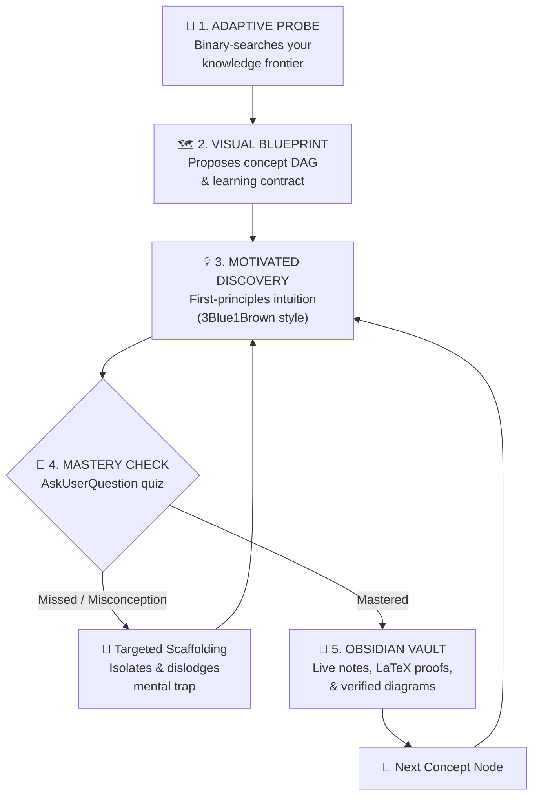
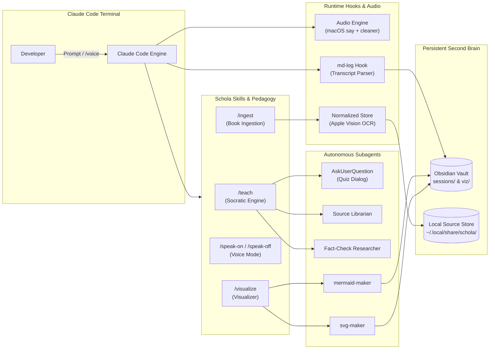

<div align="center">

# 🎓 Project Schola
### *The Autonomous Socratic Private Tutor for Claude Code*

**Stop drowning in passive 40-page documentation and falling asleep to 30-hour video courses.**

Schola transforms Claude Code into an elite, private 1-on-1 Socratic tutor. It pinpoints the exact frontier of your knowledge through adaptive binary-search probing, reconstructs core intuition from unconditional truths ([3Blue1Brown](https://www.3blue1brown.com/)-style), locks in comprehension with interactive mastery checks, ingests entire textbooks with verified citations, and continuously compiles your personal second brain in Obsidian—complete with live $\LaTeX$ math, custom diagrams, and zero-latency voice interaction.

[](https://claude.com/claude-code)
[](https://apple.com)
[](https://obsidian.md)
[](tests/run.sh)
[](#)

[Why Schola](#-the-schola-difference) • [Core Capabilities](#-features-built-for-deep-mastery) • [Architecture](#-system-architecture) • [Quickstart](#-2-minute-quickstart) • [How to Use](#-how-to-use-walkthrough) • [Textbook Ingest](#-textbook--source-ingestion-mode) • [Voice Mode](#-hands-free-voice-tutor) • [Obsidian Sync](#-the-live-obsidian-knowledge-base) • [Cheat Sheet](#-command--skill-cheat-sheet) • [Testing](#-verification--test-suite)

---

</div>

## 💡 The Schola Difference

Most learning tools fail because they teach to an imaginary "average" developer:
* **Static Docs & Video Courses** move at an arbitrary, fixed pace. They drag through fundamentals you've mastered for years, then breeze past the exact conceptual leap where your intuition breaks down. Skimming creates a dangerous illusion of competence that evaporates the moment you hit production.
* **Generic AI Chatbots** act like sycophantic "yes-men." They vomit 2,000-word walls of unverified text, nod along when you nod, ask rhetorical questions, and leave your hard-won insights trapped in ephemeral chat tabs.

**Project Schola replaces passive consumption with active cognitive apprenticeship:**



| Learning Dimension | Traditional Courses & Docs | Standard AI Chatbots | Project Schola |
| :--- | :--- | :--- | :--- |
| **Pacing & Edge** | Rigid, one-size-fits-none curriculum | Assumes you know what to ask; no calibration | **Adaptive Calibration**: Binary-searches prerequisite edges before teaching |
| **Explanation Model** | Proclaims facts & arbitrary formulas | Rambles in unstructured text walls | **Motivated Discovery**: 3B1B-style first-principles derived from unconditional truths |
| **Comprehension Check** | None (passive reading / watching) | Rhetorical questions easily skirted | **Formative Checks**: Native `AskUserQuestion` dialogs with shuffled diagnostic distractors |
| **Source Authority** | Isolated opinions or outdated blogs | Hallucinates plausible citations from memory | **Verified Source Ingest**: Page-numbered citations verified against book text (`/ingest`) |
| **Visual Intuition** | Static, pre-rendered illustrations | Text-only or unchecked pseudo-diagrams | **Self-Healing Visualizers**: Subagents render, inspect, repair, and embed SVG & Mermaid |
| **Knowledge Retention** | Manual note-taking (high friction) | Ephemeral chats lost on tab close | **Zero-Friction Vault**: Automatic real-time Obsidian compilation with math & diagrams |
| **Interface Modality** | Screen-locked reading | Keyboard-bound typing | **Conversational Voice**: Zero-latency hands-free spoken tutoring via macOS `say` + `/voice` |

---

## ⚡ Features Built for Deep Mastery

### 🎯 1. Diagnostic Edge Probing
Schola never presumes what you know or don't know. When you run `/teach <topic>`, it initiates an adaptive diagnostic inquiry:
* **Brackets the Frontier**: A run of correct answers isn't "done"—it proves the questions were too easy. Schola sharply escalates difficulty until your boundary is found.
* **Pinpoints Misconceptions**: When you miss a question, Schola doesn't just feed you the answer. It probes around the error to distinguish a careless slip from a deeply held misconception.
* **Interactive Learning Contract**: Before delivering a single lecture, Schola drafts a clear learning plan and renders a Mermaid DAG of concept dependencies for your sign-off.

### 💡 2. 3Blue1Brown-Style First-Principles Pedagogy
Facts feel arbitrary when they feel decreed rather than discovered. Schola grounds every explanation in two immutable principles:
* **Principle I: Unconditional Truths First**: Ground the discussion in invariant, caveat-free foundational truths (*"All communication between computers is done through packet transmission"*). The human brain locks in unconditional truths immediately because there's no cognitive need to hedge against future contradictions.
* **Principle II: "How Could I Have Discovered This?"**: Walk through the exact motivating problem that forced the original creators to invent the concept. No formulas appear out of thin air; every intermediate step feels like a move you could have reached for yourself.

### 🧩 3. Formative Multi-Choice Mastery Checks
No hand-waving or rhetorical questions. Every micro-concept ends with a structured check delivered through Claude Code's native `AskUserQuestion` interactive terminal prompt:
* **Parallel Syntactic Construction**: Every option is a bare claim built from the exact same syntactic skeleton. Correct answers never give themselves away with telltale explanations or extra length.
* **Dynamic Option Shuffling**: Substantive options are randomly shuffled every time—the right answer never predictably sits in slot 1.
* **Diagnostic Distractors**: Distractors are engineered around concrete real-world misconceptions, exposing flawed mental models instantly.
* **Calibration Escape Hatch**: A dedicated *"I haven't encountered this yet"* option prevents lucky guesses and protects calibration integrity.

### 📚 4. Textbook & Paper Ingestion (`/ingest`)
Feed Schola any seminal engineering book, research paper, or lecture deck:
* **Intelligent Document Processing**: Native Apple Vision OCR on macOS, robust PDF text layer extraction, and automatic page-label alignment (correcting for roman numeral prefaces and inconsistent footers).
* **Chapter Unit Maps**: Parses book outlines into bite-sized pedagogical units (3–8k tokens) with tracked progress (`started`, `done`, `skipped`).
* **Zero-Hallucination Citations**: Claims taught from an ingested book are strictly anchored to verified citations `(p. 78: "exact quote")`. If a concept lies outside the source text, Schola explicitly flags it as *(not in the book)* or *(since publication)*.

### 🎨 5. Autonomous Visualizer Subagents
When an abstract concept clicks best as a visual, Schola invokes dedicated maker subagents:
* **`mermaid-maker`**: System topologies, sequence lifecycles, state machines, and concept DAGs.
* **`svg-maker`**: Coordinate geometry, mathematical function plots, vector fields, and number lines.
* **Render-Inspect-Repair Loop**: Makers compile diagrams to PNG, inspect them visually with multimodal checks, correct any rendering defects or overcrowding, and save the verified artifact to `$OBSIDIAN_VAULT_PATH/viz/`.

### 🎙️ 6. Zero-Latency Hands-Free Voice Mode
Convert your terminal into an interactive private seminar:
* **Speech Synthesis Out**: Spoken aloud via macOS `say`. Schola's audio engine (`speak-clean.sh`) intelligently strips code fences, ASCII tables, and Markdown punctuation while spelling out mathematical formulas phonetically ($f(x) = x^2$ is spoken naturally as *"f of x equals x squared"*).
* **Spoken Input**: Dictate replies naturally using Claude Code's native `/voice` mode.
* **Instant Interruptibility**: Hitting any key or submitting input immediately silences the tutor via SIGTERM process tree reaping—zero runaway audio.

### 📓 7. Real-Time Obsidian Second Brain Sync
Never pause your learning momentum to take notes. Schola's background transcript hook (`md-log-stop-hook.sh`) automatically formats every exchange into Obsidian:
* Generates clean session logs under `sessions/<date> <topic>.md`.
* Renders pristine $\LaTeX$ math blocks (`$$...$$`), inline diagram links, and recorded quiz history with explanations.
* Keeps track of source reading progress and quiz scores across multiple study sessions.

### 🧪 8. 745+ Passing Regression Tests
Schola is engineered with production-grade rigor: **745+ automated regression tests** validate hook lifecycle events, concurrent session locking, audio interrupts, permissions sandboxing, OCR fallback mechanisms, and citation verifiers.

---

## 🏗️ System Architecture



### Extensible Repository Layout

```
.
├── skills/
│   ├── teach/            # Core Socratic engine: Probe → Plan → Teach (/teach)
│   ├── ingest/           # Document ingestion & citation pipeline (/ingest)
│   ├── visualize/        # Visualizer dispatch orchestrator (/visualize)
│   ├── speak-on/         # Speech output activation (/speak-on)
│   └── speak-off/        # Speech silence & audio deactivation (/speak-off)
├── agents/
│   ├── mermaid-maker.md  # Self-healing Mermaid diagram generator
│   ├── svg-maker.md      # Self-healing vector SVG diagram generator
│   └── researcher.md     # First-principles topic researcher & fact-checker
├── hooks/
│   ├── md-log-stop-hook.sh  # Live Obsidian session log builder
│   ├── source-brief.sh      # Ingested unit brief & progress tracker
│   ├── source-ingest.sh     # OCR, layout parser, and document normalizer
│   ├── speak*.sh            # Speech cleaner, process reapers, and audio queues
│   └── status-line.sh       # Terminal status-bar indicator (🔈/🔊)
└── tests/
    ├── run.sh            # Complete test harness (745+ tests)
    └── source/           # Source ingestion, safety, and citation test suites
```

---

## 🚀 2-Minute Quickstart

### Step 1: Install System Prerequisites

Schola requires macOS (for native speech synthesis and Apple Vision OCR) and a few lightweight CLI utilities:

```bash
brew install mermaid-cli librsvg jq
```
* `mermaid-cli` (`mmdc`): Renders structural and dependency diagrams.
* `librsvg` (`rsvg-convert`): Compiles clean SVG vector graphics into high-resolution images.
* `jq`: High-speed JSON stream transformation for hook events.

---

### Step 2: Configure Your Obsidian Knowledge Base

Point Schola to your Obsidian vault directory (or create a dedicated learning vault):

```bash
# Add to ~/.zshrc or ~/.bashrc for persistence:
export OBSIDIAN_VAULT_PATH=~/Obsidian/learn
mkdir -p "$OBSIDIAN_VAULT_PATH/viz"
```

Open [Obsidian](https://obsidian.md), choose **Open folder as vault**, and point it to `~/Obsidian/learn`. All study sessions will compile into `sessions/` and diagrams into `viz/`.

---

### Step 3: Launch Claude Code with Schola

Clone the repository and launch Claude Code pointing to the plugin:

```bash
git clone https://github.com/OJ102/ProjectSchola.git ~/learn
claude --plugin-dir ~/learn
```

---

## 📖 How to Use: Walkthrough

### 🎓 1. Freeform Topic Mastery (`/teach <topic>`)

Master any topic from first principles. Type `/teach` followed by your subject:

```
/teach Transformer Self-Attention Mechanism
```
*(Or try `/teach Raft Consensus Algorithm`, `/teach Rust Lifetimes & Borrow Checker`, or `/teach Fourier Transforms`)*

#### Phase 1: The Diagnostic Probe
Schola maps out the exact boundary of your understanding using interactive terminal dialogs:

```
┌─────────────────────────────────────────────────────────────────────────────┐
│ ? What fundamental constraint of recurrent networks (RNNs) does           │
│   self-attention eliminate during training?                                 │
│                                                                             │
│ ❯ Sequential token dependency preventing parallel matrix operations         │
│   Lack of capacity to store discrete token embeddings                       │
│   Quadratic memory explosion during forward inference                       │
│   Inability to process non-text multimodal tokens                           │
│   I haven't encountered this yet                                            │
└─────────────────────────────────────────────────────────────────────────────┘
```

#### Phase 2: Visual Concept Roadmap
Once your frontier is pinned, Schola presents a transparent dependency DAG and waits for your confirmation:

```
Roots: [Dot-Product Vector Similarity] + [Weighted Averages]
                         │
                         ▼
             [Query, Key, Value Projections]
                         │
                         ▼
             [Scaled Softmax Normalization]
                         │
                         ▼
       Goal: [Multi-Head Self-Attention Intuition]
```

#### Phase 3: Socratic Dialogue & Mastery Checks
Each node is motivated, discovered, and locked in with a formative check before moving forward.

---

### 📚 2. Textbook & Source Ingestion Mode

Turn any dense technical book or paper into your private tutor's syllabus.

#### Step 1: Ingest the Source
```
/ingest ~/Books/DesigningDataIntensiveApplications.pdf --slug ddia
```

Schola executes OCR (via macOS Apple Vision), normalizes page numbers, extracts the table of contents, and creates structured pedagogical units:
```
✓ Ingest complete: ddia
  Title: "Designing Data-Intensive Applications" (Martin Kleppmann)
  Pages: 562 total (Roman numerals i..xxiv, Arabic 1..538 normalized)
  Units: 12 chapters, 36 modular study units
  Status: Ready for instruction via /teach ddia
```

#### Step 2: Teach from the Source
```
/teach ddia
```
Schola reads the ingested units, displays the curriculum roadmap, and guides you chapter by chapter:
* **Strict Citations**: Every claim is cited directly from the text: *(p. 152: "B-trees break a database down into fixed-size blocks or pages...")*.
* **Progress Tracking**: Completed units are automatically marked as `done` with your quiz scores recorded in Obsidian.
* **Resume Anytime**: Returning to `/teach ddia` picks up right where you left off.

---

### 🎙️ 3. Hands-Free Voice Tutor

Transform learning into an immersive conversational seminar.

```
/speak-on    # Activates speech output via macOS say
/speak-off   # Silences audio immediately and disables speech
```

* **Natural Speech**: Text and conceptual explanations are read aloud in real-time. Code blocks, tables, and raw URLs stay pinned visually on screen.
* **Hands-Free Dictation**: Use Claude Code's native `/voice` mode. Hold **Space** to dictate your thoughts, release to transcribe, and press **Enter**.
* 🎧 **Headphones Recommended**: Always wear **headphones** when combining `/speak-on` with `/voice` dictation. This prevents your microphone from picking up the tutor's spoken output.
* **Instant Interrupt**: Pressing any key or submitting a reply cancels active speech mid-sentence.

#### Voice Engine Environment Configuration

Customize voice synthesis via environment variables in your `~/.zshrc` or `~/.bashrc`:

| Environment Variable | Default | Description |
| :--- | :--- | :--- |
| `SPEAK_CMD` | `say` | Audio command. Example: `export SPEAK_CMD="say -v Samantha -r 200"` |
| `SPEAK_STATE_DIR` | `~/.claude/learn-voice-teacher` | Directory storing runtime PID files, lockfiles, and speech flags |
| `SPEAK_MAX_CHARS` | `6000` | Safety threshold capping spoken characters per response turn |

#### Live Status Line Indicator

Add real-time speech indicators to your Claude Code status bar (**🔈 speech on** when idle, **🔊 speaking** when audio is playing). Add this configuration block to `~/.claude/settings.json`:

```json
{
  "statusLine": {
    "type": "command",
    "command": "bash /path/to/learn/hooks/status-line.sh",
    "refreshInterval": 2000
  }
}
```
*(Replace `/path/to/learn` with the absolute path to your Project Schola directory).*

---

### 🎨 4. On-Demand Visuals (`/visualize`)

Need a visual model to grasp a difficult concept? Ask for a visualization at any point:

```
Can you visualize how the Raft consensus leader election handles split votes?
```
Schola briefs `mermaid-maker` or `svg-maker`, verifies the resulting graphic through an iterative visual inspection loop, and embeds it directly into your session notes.

---

## 📓 The Live Obsidian Knowledge Base

Every session note is compiled cleanly from the execution transcript at the end of every reply. You get a permanent, beautifully organized personal knowledge base:

```
$OBSIDIAN_VAULT_PATH/
├── sessions/
│   ├── 2026-10-12 Transformer Attention Mechanisms.md
│   └── 2026-10-14 Raft Consensus Algorithm.md
├── viz/
│   ├── query-key-dot-product.png
│   └── raft-split-vote-timeline.png
└── progress/
    └── ddia-progress.md
```

Each generated markdown session contains:
- Mathematical equations rendered in standard $\LaTeX$ (`$$...$$`).
- Embedded, verified diagrams rendered by the visualizer subagents.
- Complete quiz records: questions asked, options presented, your answers, and full pedagogical explanations.
- Verified textbook page citations and unit progress metrics.

---

## ⚡ Command & Skill Cheat Sheet

| Command / Trigger | Purpose | Example |
| :--- | :--- | :--- |
| `/teach <topic>` | Start an interactive Socratic mastery session on any concept | `/teach Eigenvalues and Eigenvectors` |
| `/teach <slug>` | Learn unit-by-unit from an ingested textbook or paper | `/teach ddia` |
| `/ingest <path>` | Ingest a PDF book or paper with OCR and verified citations | `/ingest ~/Books/ml.pdf --slug ml-book` |
| `/speak-on` | Enable spoken audio responses via macOS `say` | `/speak-on` |
| `/speak-off` | Mute and disable spoken audio responses | `/speak-off` |
| `/voice` | Dictate your questions and answers via voice input | `/voice` (Hold Space to speak) |
| `/visualize` | Explicitly request a verified Mermaid or SVG visual | `/visualize the TCP 3-way handshake` |

---

## 🛠️ Verification & Test Suite

Project Schola is built with software engineering discipline. The system includes **745+ automated regression tests** verifying process lifecycles, concurrency locks, audio cleaners, prompt submission interrupts, and PDF ingestion contracts.

Run the test suite locally:

```bash
# Run the entire regression suite (745+ tests)
bash tests/run.sh

# Run documentation & reference assertions
bash tests/run.sh docs

# Run source ingestion & citation contract tests
bash tests/run.sh adapter-contract

# Run voice toggling & state tests
bash tests/run.sh toggle

# Run audio cleaner & LaTeX normalization tests
bash tests/run.sh cleaner

# Run process interrupt & audio reaping tests
bash tests/run.sh interrupt
```

---

## 🔍 Troubleshooting

<details>
<summary><b>Command <code>/teach</code> or <code>/ingest</code> is not recognized</b></summary>

Ensure Claude Code is started with the `--plugin-dir` flag pointing directly to your local clone:
```bash
claude --plugin-dir /path/to/learn
```
If a naming collision occurs with another installed plugin, invoke using the fully qualified namespace: `/learn-voice-teacher:teach` or `/learn-voice-teacher:ingest`.
</details>

<details>
<summary><b>Session notes do not appear in Obsidian</b></summary>

1. Confirm `jq` is installed and available in your shell: `which jq`.
2. Ensure `OBSIDIAN_VAULT_PATH` is exported in the shell before launching Claude Code:
   ```bash
   echo $OBSIDIAN_VAULT_PATH
   ```
3. Check `$OBSIDIAN_VAULT_PATH/sessions/`. Notes are generated and updated after every assistant response.
</details>

<details>
<summary><b>Diagrams are missing or show broken image links</b></summary>

Verify diagram rendering dependencies:
```bash
which mmdc && which rsvg-convert
```
Ensure `$OBSIDIAN_VAULT_PATH/viz` exists so maker subagents can save rendered PNG artifacts.
</details>

<details>
<summary><b>No audio output during voice mode</b></summary>

1. Audio output requires macOS `say`. Verify speech status:
   ```bash
   bash hooks/speak-toggle.sh status
   ```
2. If `SPEAK_CMD` is customized in your environment, verify the command is executable in your `$PATH`.
</details>

<details>
<summary><b>Tutor audio triggers microphone feedback during dictation</b></summary>

Always wear **headphones** when combining `/speak-on` with `/voice` dictation, or toggle audio off temporarily with `/speak-off`.
</details>

<details>
<summary><b>PDF Ingestion fails or stalls on scanned books</b></summary>

For scanned PDFs lacking a text layer, Schola uses Apple Vision OCR on macOS. Ensure the file has read permissions. For very large books (>500 pages), ingestion runs in incremental stages. Re-running `/ingest <path>` resumes from the last completed page.
</details>

---

## 🤝 Philosophy & Acknowledgments

Project Schola is founded on cognitive science and the pedagogical conviction that **true understanding is a connected dependency graph, not a bag of memorized propositions.**

* Inspired by the learning workflows explored by [Amos Blomqvist](https://github.com/amosblomqvist) in *How I Use AI to Learn Things*.
* Visual and mathematical discovery principles inspired by [Grant Sanderson](https://www.3blue1brown.com/) (3Blue1Brown).
* Designed, engineered, and maintained by **[Om Jadhav](https://github.com/OJ102)**.

*Empowering engineers to master foundational concepts deeply, intuitively, and permanently.*
